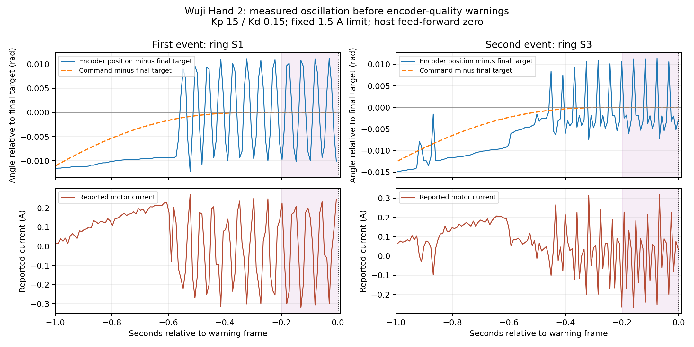

# Wuji Hand 2 encoder-warning investigation — 2026-10-27

**The two ring-finger warnings are associated with oscillating angle feedback and
reversing motor current while the commanded angle is stationary.** This narrows
the investigation to a drive/feedback interaction, but does not establish whether
the encoder initiates it or whether firmware is misclassifying the signal.
A subsequent watched repeat corroborated a physical twitch, as linked below.
The thumb accuracy improvement remains valid; it does
not qualify the same gains for coordinated ring-finger operation.

This investigation analyzed the existing motion records, performed new read-only
hardware diagnostics, and searched official documentation, release notes, GitHub
issues/PRs, discussion availability, and public forums. **No new motion, enable,
configuration write, fault clear, or firmware change was performed.**

A subsequently authorized [watched replay](wuji-visual-replay-2026-10-27.md)
reproduced ring S3 angle/current oscillation at Kp 15 with smaller, slower moves.
The new early guard stopped it without a native encoder warning. A Kp 5 replay
was steady and the operator reported no trembling or contact. That follow-up is
separate from the read-only investigation documented below. A further explicitly
requested repeat reproduced a 0.777° ring S3 feedback swing on the final return,
and the operator confirmed a visible twitch. The early guard stopped that run
without an encoder warning as well. This supersedes the lack of independent
visual evidence in the initial investigation, without establishing which part
of the drive/feedback interaction starts the problem.

The subsequent [moderate-gain sweep](wuji-ring-stability-sweep-2026-10-27.md)
completed 38 returns with no detected repeated oscillation or encoder warning,
including repeated motions at the older warning-run amplitude and speed. The
operator selected Kp 10/Kd 0.15 for the tested ring bending joints. These results
support the association with control behaviour without establishing causality.

## Evidence from the two interrupted trials

Both trials used the native SDK directly, outside RAX and its MCP wrapper:
ring S1/S3/S4 moved together through ±0.04 rad excursions, with 2-second quintic
ramps at 120 Hz, Kp 15/Kd 0.15, a fixed 1.5 A current cap, and zero host effort
feed-forward. Other joints held their measured starting positions at 1.5/0.1/0.5 A.
The starting postures differed between trials.

The shaded final 0.2 seconds have an exactly constant command in both records:

| Measurement in that interval | First event: ring S1 | Second event: ring S3 |
| --- | ---: | ---: |
| Native diagnostic | 3, `Enc1BitRate` | 3, `Enc1BitRate` |
| Position peak-to-peak | 0.02131 rad / 1.22° | 0.01854 rad / 1.06° |
| Reported current range | −0.320 to +0.244 A | −0.268 to +0.319 A |
| Current sign changes in sampled trace | 8 / 25 samples | 18 / 24 samples |
| Reported supply | 12.382–12.394 V | 12.371–12.394 V |
| MCU temperature | 55.00–55.05 °C | 53.49–53.59 °C |
| Current-limit flag | Never asserted | Never asserted |
| Largest host command interval | 8.44 ms | 8.73 ms |

Ring S1 also oscillated by 0.01991 rad peak-to-peak before the second event,
although only S3 reported the warning. Earlier holds within these same trials
were much steadier. Previously successful isolated S1/S3 tests at the same gains
and cap had final one-second position ranges of 0.000202/0.000117 rad. Their
whole-trial peak currents were about 0.30 A and their temperatures were comparable.
Those are useful comparisons, but differing postures and joint coordination make
them unsuitable as a controlled gain A/B experiment.

The angle oscillation precedes **assertion of the diagnostic**. The diagnostic
counts a proportion of flagged encoder frames, and its accumulation window and
threshold are not published in the resources reviewed. Therefore this ordering
does not prove that oscillation began before encoder signal degradation.
Likewise, position and velocity telemetry are not independent physical motion
measurements. Finite-differencing the same encoder samples cannot resolve that
ambiguity, and the 120 Hz trace does not establish the full oscillation spectrum.

The operator reports **no nearby objects beyond the robot's mounting hardware**.
An initial report of smooth, quiet motion was subsequently qualified: the
operator was not paying close attention. **Visible or audible oscillation is
therefore unknown**, and that initial response is not evidence against actual
vibration. The external-object observation does not exclude internal motor
movements, magnet alignment problems, mounting-related magnetic effects, or
feedback noise.
The existing camera views do not independently resolve the ring joints.

## Meaning of the warning

The installed SDK 2026.10.12 identifies code 3 as an excessive fraction of Encoder
1 frames carrying the chip's data-quality warning flag. Severity is `Warning`,
clearing policy is `AutoClear`; the catalog points to encoder/magnet positioning,
seating and alignment. This is distinct from bus CRC and frame-format codes 5/6.
It does not mean Ethernet bitrate or an excessive current command.

An **offline lookup using the official 2026.10.26 SDK wheel** independently
confirmed the same code, meaning, severity and clearing policy. The wheel was
unpacked into the ignored investigation directory; the project's environment was
not upgraded and that SDK was not connected to hardware. This rules out a stale
code-3 description in the installed SDK as the explanation.

The SDK calibration type describes Encoder 1 as motor-side. The public resources
reviewed do not expose its per-frame quality flags, their rate/window, magnet
strength, or independently separated raw encoder angles. These are useful vendor
diagnostics to request; no encoder or origin calibration was attempted.

Warnings do not themselves automatically stop motors. Our harness deliberately
stopped on the warning; the second run confirmed all joints disabled about
28.8 ms after its diagnostic frame. That is observed feedback timing, not a
guaranteed physical stop time. See [Wuji's maintenance guidance](https://docs.wuji.tech/docs/en/wuji-hand/latest/maintenance).

## New read-only hardware checks

Device: right Hand 2, SN `WH2KA01260823017`, HW 0.2.0, firmware 2.13.1,
SDK 2026.10.12, endpoint `192.168.1.111:50001`.

- A 30-second disabled observation, plus initial resource reads, received 32,012
  native diagnostic frames with no nonzero code or callback error. All twenty
  joints remained disabled. Ring S1/S3 position ranges were only
  0.0000280/0.0000277 rad; the maximum over any joint was 0.0000323 rad.
- All twenty joints were online, with 100% reported response and zero timeouts.
  Finger-bus CRC, frame-format and UART hardware error counters were zero.
  The extra offline node in each five-node finger group is an unfitted tactile
  slot, not a missing joint.
- Host communication telemetry reported zero packet losses, reorderings,
  duplicates, SDK drops, RPC retries/timeouts, and communication GET failures.
  These are current-session checks. The older warning traces contain clean
  per-joint response/timeout telemetry, but not an equivalent complete host-link
  history during those motions.
- Every joint's error status/code was clear; all twenty `error_log` reads were
  empty. Hand 2's persisted history concerns faults active at the previous power
  loss, so empty history does not contradict the recorded live warnings.
  See [fault-log semantics](https://docs.wuji.tech/docs/en/wuji-sdk/latest/device-fault-logs).
- Original gains 1.5/0.1 and 0.5 A limits were read back on every joint. The xArm
  stayed fault-free in state 5 at its unchanged pose. No production controller,
  configured gains, saved home, or calibration was changed by this investigation.

These checks show quiet feedback at rest and a clean current communication link.
They do not certify encoder behavior under motor drive, or rule out fast local
power/EMI disturbances that ordinary telemetry cannot resolve.

## What the public sources actually say

**Official guidance:** Wuji directs encoder-warning investigations toward the
affected joint's wiring/signal quality and nearby magnetic objects, with power
removed for physical inspection. Recurrence after those checks is directed to
hardware support. This is a service recommendation, not a diagnosis of our hand
without inspection. Internal magnet adjustment is not an operator tuning step.
See [troubleshooting](https://docs.wuji.tech/docs/en/wuji-hand/latest/troubleshooting)
and [user notice](https://docs.wuji.tech/docs/en/wuji-hand/latest/user-notice).

**There is a documented firmware precedent:** the July 21 firmware **2.1.0**
release fixed spurious encoder warnings during high-speed operation and revised
encoder health monitoring. Our **2.13.1** is already newer and is the current
release listed on October 27. That historical fix makes firmware behavior a
legitimate hypothesis, but does not establish a current regression or provide
another documented upgrade fix. The October 26 SDK adds automatic fault logging;
our October 12 SDK predates that feature. The logging improvement is not described
as an encoder repair. See [official release notes](https://docs.wuji.tech/docs/en/release-notes).

**A relevant independent Hand 2 implementation:** `aiowuji` describes stick-slip
and questionable reported velocity near rest, and experiments with current
feed-forward. Its controller records `Warning` severity in a warning set and
continues; more severe codes stop it. That handling choice can make an experiment
continue through a warning, but is not evidence that the encoder problem is
solved. We retained our stop behavior. See the pinned
[author's README](https://github.com/younghyopark/aiowuji/blob/0fca23cc855369c9c258ad16c087e8cb00d1a7f7/README.md)
and [warning handler](https://github.com/younghyopark/aiowuji/blob/0fca23cc855369c9c258ad16c087e8cb00d1a7f7/src/aiowuji/controller.py#L556).

**No matching public resolution found.** The search covered:

- All-state issue/PR lists for official `wuji-sdk`, `wuji-studio`, `wuji-cli`,
  `wuji-mjlab`, `wuji-ros2`, `wujihandpy`, and `wujihand-upgrader`, plus `aiowuji`;
  relevant issue comments were read. Exact `Enc1BitRate` and broader encoder
  searches were also performed. All 25 returned official organization
  repositories, and `aiowuji`, had GitHub Discussions disabled.
- The visible public [Wuji community forum](https://community.wuji.tech/),
  its latest-topic index and searches for encoder, Hand 2 and `Enc1BitRate`.
  No matching thread appeared. The visible FAQ concerns the older hand; its
  interface “Version 2” wording is not evidence of a Hand 2 remedy.
- English and Chinese web searches, GitHub-indexed discussions and Reddit
  discussions. Announcement posts and speculation offered no verified fix.

Resolved older-generation issues, including
[Hand 1 freezing #28](https://github.com/wuji-technology/wujihandpy/issues/28)
and [Hand 1 filtering #29](https://github.com/wuji-technology/wujihandpy/issues/29),
do not establish a Hand 2 encoder fix. Private support conversations and
unindexed forums are outside this search. A malformed broad GitHub query was
discarded; the negative finding is based on the relevant repository lists and
targeted searches, not a claim to have examined every global “warning” result.

## What remains to isolate

| Hypothesis | Evidence and limitation |
| --- | --- |
| Controller-driven oscillation affects encoder quality | Constant-target angle/current oscillation supports a feedback-loop interaction. Visible chatter is unknown; actual internal motion is not independently measured. |
| Encoder/magnet signal degrades first, controller reacts | Fits the native chip-quality warning. Quiet disabled readings do not exclude a drive-dependent sensor problem; operator observation does not distinguish these hypotheses. |
| Firmware monitoring/feedback issue | A historical false-warning fix exists. No matching current-version public fix found. |
| Host scheduling/network failure | No relevant gaps, timeouts or error codes in the available event telemetry; current bus/link checks are clean. Full event-time link telemetry is incomplete. |
| Changing current cap, saturation, or temperature alone | Cap stayed at 1.5 A, observed current was about 0.32 A or less, and no limit flag appeared. Successful isolated trials had similar current and temperature. Fast unmeasured electrical effects remain possible. |

The next discriminating experiment should combine **independent observation of
the ring finger** with a small, matched low-gain test, rather than another
whole-hand parameter sweep. Hold starting pose, trajectory, damping, cap, command
rate and firmware compensation fixed; change one factor at a time. Start below
the problematic Kp 15 profile, compare isolated S1/S3 with coordinated S1/S3/S4,
and use a small excursion before increasing it. Lower Kp values such as 5, 8 and
10 are candidates, not validated settings. Keep host effort feed-forward zero.

An early fixed-target oscillation detector should stop the test before a warning
accumulates, in addition to the existing diagnostic/current/temperature/feedback
guards. Its threshold must be checked against healthy traces; a proposed value
is not a vendor safety limit. Do not rerun the known problematic Kp 15 condition
just to produce another warning. Reducing the current cap alone would not be a
controlled explanation while observed current remains far below both caps.

Raw motor/output encoder angles and quality flags from Wuji would distinguish
feedback corruption from real internal motion much better than more gain trials.
A local support draft asks about those measurements and the old high-speed
false-warning fix. No support message has been sent. Root cause and a reliable
full-hand profile remain **unresolved**; the hand stays disabled.

## Reproduction and retained evidence

The [prior resumption report](wuji-shortlist-validation-2026-10-27.md) retains both
warning event records and stop/restoration evidence. This investigation's raw
readbacks, analysis scripts, metrics, query results and source snapshots are in
`.local-runtime/wuji-encoder-isolation-20261027/` (ignored by Git).

The [combined local evidence archive](../.local-runtime/wuji-encoder-isolation-20261027/wuji-encoder-isolation-evidence-2026-10-27.zip)
includes the prior motion evidence archive, this analysis, new read-only
diagnostics, a support draft and a SHA-256 manifest. It has not been transmitted.
