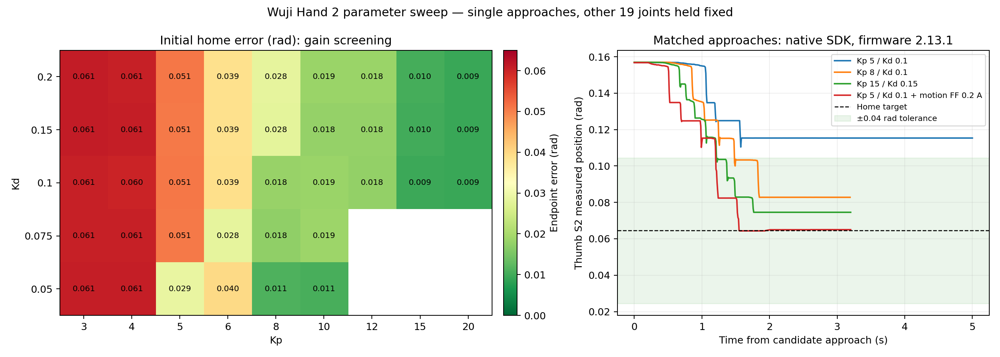

# Wuji Hand 2 parameter sweep — 2026-10-27

Follow-up: the [operator-requested guarded resumption](wuji-shortlist-validation-2026-10-27.md)
produced a second `Enc1BitRate` warning, this time on ring S3. Its wider comparison
stopped before the remaining shortlist cases. The original sweep below remains
the evidence for the tracking improvements; no configuration has been promoted.

**Controller tuning substantially improves encoder-relative tracking.** The
thumb study completed 95 native-SDK trials on firmware 2.13.1. Kp 15/Kd 0.15
with a 1.0 A cap completed six saved-thumb-home returns from both directions
with 0.00864–0.00984 rad error (0.50–0.56°), without a warning or guard stop.
The Kp 5/Kd 0.1 reference repeatedly left approximately 0.0508 rad (2.91°).

Motion-only friction compensation at Kp 5/Kd 0.1 also completed six returns.
Its positive-side returns were excellent, 0.000443–0.000488 rad, but returns
from below home left 0.01980–0.01985 rad. The best single approach is therefore
not a general precision claim. Combining Kp 8 with the same compensation passed
six returns, with 0.00816–0.00821 rad from above and 0.01818–0.01861 rad from below.
The stiff profile has the best worst-case home error among these repeated tests.

The moderate Kp 8/Kd 0.1/0.75 A position-only profile passed initial approaches
but tripped the existing SDK-reported speed guard on the second positive
excursion. It is excluded from broader qualification. A low-damping Kp 3/Kd
0.025 trial also tripped that guard. Kp 5/Kd 0.1 at a 0.5 A cap produced a thumb
S2 `Stall` warning with its current-limit flag active. All three stopped and
disabled successfully; no diagnostic was manually cleared. Five stronger-Kp
cells at Kd 0.025 and the Kp 8/0.5 A case were deliberately not attempted.

The baseline was rechecked at the end and still left 0.05072 rad error, which
argues against simple warm-up or elapsed time explaining the improvements.
These results support a controls/friction contribution. They do not prove the
absence of mechanical problems or independently verify physical joint angles.

**Broader qualification stopped on an encoder warning.** All twenty joints
passed isolated local moves and returns. Coordinated flexion passed on the thumb,
index and middle fingers, but ring S1 reported `Enc1BitRate` during its final
return hold. The harness disabled all twenty joints. The warning later cleared
automatically while disabled, and the original gains/current limits were restored
and read back. No further motion was attempted. Production gains, current cap,
saved home and controller code remain unchanged. These results do not yet qualify
reliable full-hand home, grasping, payloads or task trajectories.

## Coverage

| Family | Completed trials | Settings |
| --- | ---: | --- |
| Firmware compensation | 8 | Modes 0–3 × position table off/on |
| Kp/Kd grid | 40 | Kp 3, 4, 5, 6, 8, 10; Kd 0.025–0.2; extended Kp 12, 15, 20 at Kd 0.1/0.15/0.2 |
| Current caps | 9 | 0.5, 0.75, 1.0, 1.5 A at selected gains; includes one protective stop |
| Trajectories | 9 | Linear/cosine/quintic × 1/2/4 seconds |
| Command rate and desired velocity | 10 | 50/120/200/500/1000 Hz × zero/analytic desired velocity |
| Motion-friction feed-forward | 4 | 0.04/0.08/0.12/0.20 A, Kp 5/Kd 0.1 |
| Persistent holding bias | 5 | 0.025/0.05/0.10/0.15/0.20 A |
| Gain/feed-forward interaction | 3 | Kp 8/Kd 0.1 with motion friction 0.08/0.12/0.20 A |
| Repeated approaches | 4 | Three profiles completed 6/6 returns; one stopped during its second excursion |
| Matched baseline/reference | 3 | Kp 1.5 at two caps; final Kp 5 reference |

All firmware-compensation combinations left 0.05057–0.05091 rad error. Command
rate, desired velocity alone and ramp shape/duration did not remove the residual
at Kp 5. Nominal 500/1000 Hz trials achieved approximately 496/989–990 Hz with
maximum recorded send gaps around 28–34 ms; 120 and 200 Hz were steadier and
had indistinguishable final error. Faster publishing is not an established fix.

At Kp 5, caps 0.75–1.5 A produced effectively identical error. At Kp 8 they also
produced effectively identical initial error, about 0.0183 rad. A larger current
cap does not by itself generate more holding current. The 0.5 A case is different:
it actually activated the current limit and the stall warning.

Motion friction approaches zero when desired velocity does. The separate
holding-bias experiment keeps its signed effort during the endpoint hold; its
small errors are not zero-feed-forward holding results. The motion-only
candidate was prioritized for broader comparison because it returns to zero
effort feed-forward at rest.

## Measurement quality and thumb-stage final state

Candidate approach starts ranged from 0.156569 to 0.157008 rad, a spread below
0.00044 rad. The largest starting drift of another held joint relative to the
shared baseline was 0.00371 rad. The maximum recorded MCU temperature was
58.49 °C, recorded absolute current 0.666 A, and supply telemetry 12.209–12.429 V.
The arm remained in state 5, without errors or warnings, at the same pose in
every trial. There were no cleanup failures. At the end of the thumb phase a
separate inspection confirmed all twenty joints disabled and restored gains
1.5/0.1 and 0.5 A limits. These are experimental observations, not device ratings.

[Full thumb trial CSV](wuji-parameter-sweep-2026-10-27.csv) includes parameters,
settling results, endpoint errors, current, SDK-reported velocity, temperatures,
command timing, diagnostics and cleanup status. Its `error` column is the maximum
across all twenty joints; `thumb_endpoint_max_error_rad` and
`endpoint_mean_error_rad` isolate the thumb. At very small thumb errors, a held
finger can dominate the all-joint maximum.

## Scope and method

The thumb stage is an isolated S2 experiment on right Hand 2 `WH2KA01260823017`,
hardware 0.2.0, firmware 2.13.1, SDK 2026.10.12, address
`192.168.1.111:50001`. The harness imports native `wuji_sdk` directly, without
RAX's controller/wrapper or MCP. It does not prove a new RAX profile works.
Only flat joint index 1 changes target or tuning. The other nineteen joints hold
one shared measured posture using Kp 1.5, Kd 0.1 and a 0.5 A limit.

Before every candidate, a fixed Kp 5/Kd 0.1/1.5 A preparation moves thumb S2
toward home +0.12 rad (0.184535). The hand then disables for two seconds, applies
and reads back the candidate's gains and current limit, seeds fresh measured
positions, enables, and approaches saved home at 0.064535 rad. This produces
comparable initial positions without redefining home. Firmware compensation
writes are acknowledged but cannot be read back.

Unless stated otherwise, the candidate uses a two-second quintic ramp at 120 Hz,
zero desired velocity and zero host effort, firmware mode 3 and position table
on, with a 1.5 A thumb current limit. Success requires all twenty joints within
0.040 rad for 0.2 seconds and then a one-second hold with error ≤0.040 rad and
peak-to-peak variation ≤0.020 rad. Failed approaches retain the original
three-second settling timeout. Passing error values are the maximum over the
hold; timed-out values are the final error. The CSV additionally records the
mean endpoint error for like-for-like comparisons.

Every trial requires fresh complete twenty-joint feedback, no diagnostics,
measured posture checks and a maximum starting temperature below 60 °C. It stops
on any diagnostic, feedback age >0.25 s, temperature ≥65 °C, send gap >0.1 s,
unexpected loss of Enabled state, tracking error >0.35 rad, or SDK-reported speed
>2 rad/s or >1 rad/s for >0.12 s. These speed readings are not independently
verified physical output speeds. Commanded trajectories retain the 0.35 rad
step, 0.5 rad/s and 1 rad/s² bounds. Linear interpolation changes velocity at the
endpoints; its endpoint discontinuity is a deliberate vendor-style comparison,
not a continuously acceleration-bounded trajectory.

The hand is disabled and its commissioning gains/current cap restored and read
back after each trial. Firmware mode 3 and position-table on are requested again
as the documented default. Batches stop for review on any guard, preparation or
cleanup failure, and pause between trials. No factory reset, persistent write,
origin change, encoder calibration, protection change or diagnostic clearing is
part of the sweep. xArm access is read-only; state 5 and its recorded pose are
checked throughout.

One-factor screens and the gain grid have one approach per cell. They are not a
statistical estimate of an optimum, and the run order is not randomized. Thermal
and friction-history effects can influence small differences. Separate repeated
approaches test candidates against that limitation. Whole-hand home and other
finger motion qualification remain separate work.

For positive repeats the target is home +0.12 rad; negative repeats use home
−0.08 rad. The sequence stops at the first failed waypoint. A failure reaching
the negative waypoint is not recorded as a completed return from below home.

RAX currently validates Kp ≤10 and command rate ≤250 Hz in
`services/wuji/config.py`. Native trials above those bounds deliberately evaluate
what the vendor supports without changing RAX's admission checks. Kp 15/20 or
500/1000 Hz results cannot be copied directly into the current RAX configuration;
promoting those would require a separate, explicit implementation and regression
review. The saved home, production gains, current limit and controller code are
not changed by this experiment.

## Gain screening

Errors in radians; **stop** means a protective stop before endpoint qualification. Blank cells were not tested. Each numeric cell is one initial approach.

| Kp | Kd 0.025 | Kd 0.05 | Kd 0.075 | Kd 0.1 | Kd 0.15 | Kd 0.2 |
| ---: | ---: | ---: | ---: | ---: | ---: | ---: |
| 3 | **stop** | 0.06078 | 0.06059 | 0.06068 | 0.06103 | 0.06116 |
| 4 | — | 0.06069 | 0.06064 | 0.06016 | 0.06074 | 0.06064 |
| 5 | — | 0.02887 | 0.05057 | 0.05081 | 0.05071 | 0.05081 |
| 6 | — | 0.03965 | 0.02839 | 0.03898 | 0.03874 | 0.03875 |
| 8 | — | 0.01108 | 0.01751 | 0.01827 | 0.02810 | 0.02839 |
| 10 | — | 0.01055 | 0.01855 | 0.01851 | 0.01780 | 0.01851 |
| 12 | — | — | — | 0.01770 | 0.01794 | 0.01837 |
| 15 | — | — | — | 0.00940 | 0.01003 | 0.01031 |
| 20 | — | — | — | 0.00930 | 0.00921 | 0.00936 |

## Other parameter comparisons

All these screens use Kp 5/Kd 0.1 unless the case name identifies another gain. The initial approach remains fixed; each row is one trial. Full settings and metrics are in the CSV.

| Case | Error (rad) | Result | Peak reported current (A) |
| --- | ---: | --- | ---: |
| baseline-kp15-cap05 | 0.09127 | settling failure | 0.304 |
| baseline-kp15-cap15 | 0.09142 | settling failure | 0.299 |
| bias-025 | 0.05058 | settling failure | 0.580 |
| bias-050 | 0.03860 | pass | 0.612 |
| bias-100 | 0.01832 | pass | 0.609 |
| bias-150 | 0.00768 | pass | 0.619 |
| bias-200 | 0.00178 | pass | 0.611 |
| cap-050 | — | protective stop | 0.526 |
| cap-075 | 0.05081 | settling failure | 0.538 |
| cap-100 | 0.05081 | settling failure | 0.538 |
| cap-150 | 0.05081 | settling failure | 0.534 |
| cap-kp15-kd150-075 | 0.01003 | pass | 0.601 |
| cap-kp15-kd150-100 | 0.00993 | pass | 0.615 |
| cap-kp8-075 | 0.01832 | pass | 0.612 |
| cap-kp8-100 | 0.01837 | pass | 0.609 |
| cap-kp8-150 | 0.01827 | pass | 0.606 |
| command-1000hz-velocity0 | 0.05076 | settling failure | 0.545 |
| command-1000hz-velocity1 | 0.05077 | settling failure | 0.541 |
| command-120hz-velocity0 | 0.05081 | settling failure | 0.530 |
| command-120hz-velocity1 | 0.05086 | settling failure | 0.534 |
| command-200hz-velocity0 | 0.05085 | settling failure | 0.537 |
| command-200hz-velocity1 | 0.05086 | settling failure | 0.550 |
| command-500hz-velocity0 | 0.05086 | settling failure | 0.545 |
| command-500hz-velocity1 | 0.05080 | settling failure | 0.540 |
| command-50hz-velocity0 | 0.05072 | settling failure | 0.532 |
| command-50hz-velocity1 | 0.05078 | settling failure | 0.532 |
| ff-mode0-position0 | 0.05080 | settling failure | 0.535 |
| ff-mode0-position1 | 0.05076 | settling failure | 0.539 |
| ff-mode1-position0 | 0.05081 | settling failure | 0.537 |
| ff-mode1-position1 | 0.05067 | settling failure | 0.529 |
| ff-mode2-position0 | 0.05062 | settling failure | 0.531 |
| ff-mode2-position1 | 0.05057 | settling failure | 0.529 |
| ff-mode3-position0 | 0.05072 | settling failure | 0.531 |
| ff-mode3-position1 | 0.05091 | settling failure | 0.544 |
| friction-040 | 0.05048 | settling failure | 0.569 |
| friction-080 | 0.03850 | pass | 0.613 |
| friction-120 | 0.01832 | pass | 0.612 |
| friction-200 | 0.00229 | pass | 0.620 |
| hybrid-kp8-friction080 | 0.01808 | pass | 0.604 |
| hybrid-kp8-friction120 | 0.01789 | pass | 0.591 |
| hybrid-kp8-friction200 | 0.00816 | pass | 0.585 |
| reference-kp5-final | 0.05072 | settling failure | 0.532 |
| trajectory-cosine-1s | 0.05081 | settling failure | 0.535 |
| trajectory-cosine-2s | 0.05087 | settling failure | 0.538 |
| trajectory-cosine-4s | 0.05090 | settling failure | 0.540 |
| trajectory-linear-1s | 0.05068 | settling failure | 0.535 |
| trajectory-linear-2s | 0.05086 | settling failure | 0.531 |
| trajectory-linear-4s | 0.05081 | settling failure | 0.543 |
| trajectory-quintic-1s | 0.05071 | settling failure | 0.531 |
| trajectory-quintic-2s | 0.05081 | settling failure | 0.540 |
| trajectory-quintic-4s | 0.05086 | settling failure | 0.533 |

## Repeated thumb-home checks

The ranges below isolate thumb S2 over each completed endpoint hold; other held
joints can dominate the all-joint error reported in the main CSV.

| Profile | Completed home returns | Thumb home error range (rad) | Overall result |
| --- | ---: | --- | --- |
| repeat-friction-200 | 6 | 0.000443–0.01985 | passed |
| repeat-hybrid-kp8-friction200 | 6 | 0.00816–0.01861 | passed |
| repeat-kp15-kd150-cap100 | 6 | 0.00864–0.00984 | passed |
| repeat-kp8-kd100-cap075 | 1 | 0.01799–0.01799 | failed |

## Isolated tests across all fingers

The separate all-finger stage executed 29 trials: 27 passed, one was deliberately
interrupted for contact review, and one stopped on an encoder warning. This is
not a reliability success rate: the cases include a watched contact probe and
different motion/profile screens. [All-finger trial CSV](wuji-all-fingers-2026-10-27.csv)
records the individual results and actual gain readbacks.

Twenty trials moved one joint at a time by +0.08 rad, back to a measured local
center, −0.08 rad, and back again. All **80 nonzero moves/returns passed**, with
no diagnostic or guard stop. The active joint used Kp 15/Kd 0.15/1.5 A; the other
nineteen held their targets at 1.5/0.1/0.5 A. Each used a two-second quintic ramp
at 120 Hz and the 0.04 rad settling criterion plus one-second hold. This is not
a test of setting all twenty joints to Kp 15 simultaneously. The local center
was measured for this experiment; it was not the saved whole-hand home.

These errors isolate the commanded joint and cover its full endpoint holds:

| Finger | Joints tested | Worst endpoint error (rad) | Worst local-center return error (rad) |
| --- | ---: | ---: | ---: |
| Thumb | 4/4 | 0.01203 | 0.01142 |
| Index | 4/4 | 0.00677 | 0.00677 |
| Middle | 4/4 | 0.00577 | 0.00499 |
| Ring | 4/4 | 0.01338 | 0.00550 |
| Pinky | 4/4 | 0.01703 | 0.00715 |

Additional pinky S2 trials at Kp 20 with Kd 0.15 and 0.20 passed, reducing its
worst endpoint error to 0.01261 and 0.01284 rad respectively. There is insufficient
repeat coverage to prefer either. The motion-friction profile passed a local
thumb S2 cycle with 0.01923 rad worst error. Its index S3 trial was intentionally
interrupted during the negative move to review ring/pinky interaction; there was
no device diagnostic or guard failure in that interrupted trial.

### Ring/pinky drift and the watched replay

During lateral pinky S2 trials, the held ring S2 target stayed fixed while its
position drifted, reaching roughly 0.021–0.024 rad target error. An earlier
progress update attributed an approximately 0.021 rad all-joint maximum to
pinky tracking; per-joint analysis corrected that attribution. It was principally
the held ring S2. This is separate from the later **ring S1** encoder warning.

The operator watched a gentler replay and confirmed **clear throughout, no
contact**. Pinky S2 used Kp 5/Kd 0.15/0.5 A and a four-second approach, moving
about 0.0277 rad (1.6°) in measured position. Ring S2 varied by less than
0.0001 rad. No warning or guard occurred, and the hand was disabled afterward.
No automatic return was attempted in that observation probe.

However, the disabled starting pose had changed substantially: ring S2 was
approximately −0.0395 rad, versus an earlier target near +0.0938 rad. The clear
replay establishes clearance for that pose and smaller motion; it cannot rule
out contact during the earlier trials. Contact, low-gain holding drift and other
coupling remain possible explanations for the earlier observation.

### Coordinated flexion

With fresh measured targets for held joints, three joints of one finger
(S1/S3/S4) moved together by ±0.04 rad and returned to their local center. All S2
lateral joints retained their measured targets. Active joints used
15/0.15/1.5 A; other joints retained 1.5/0.1/0.5 A. Active-joint acceptance was
tightened to 0.02 rad, with an additional stop for held-S2 drift above 0.01 rad.

| Finger | Four moves/returns | Worst active endpoint error (rad) | Result |
| --- | --- | ---: | --- |
| Thumb | 4/4 | 0.01133 | Passed |
| Index | 4/4 | 0.01151 | Passed |
| Middle | 4/4 | 0.00445 | Passed |
| Ring | 3/4 qualified | — | Encoder warning during final return hold |
| Pinky | Not attempted | — | Batch stopped |

The ring final return reached its settling gate, but its hold was interrupted;
it is not a passed return. Full-hand coordinated motion, coordinated feed-forward
comparisons, full saved-home transitions and manipulation were not attempted.
Prepared specifications for these cases are plans, not test evidence.

## Ring S1 encoder warning and final state

During `flexion-stiff-ring`, ring S1 (flat index 12, NID 16) reported code 3,
`Enc1BitRate`. The installed SDK describes this as a high rate of Encoder 1
data-quality flags, severity `Warning`, policy `AutoClear`. Its suggested
investigation concerns encoder/magnet position, seating and alignment. This is
an observed diagnostic, not proof of a specific mechanical defect or a causal
explanation for the earlier thumb error. [Structured event record](wuji-encoder-warning-2026-10-27.json)

At detection, ring S1 measured 0.02907 rad against a 0.03364 rad target, with
−0.130 A reported current, 55.0 °C MCU temperature and 12.394 V supply. Its
current-limit flag was false; communication reported 100% response and zero
timeouts. Reported velocity was 1.004 rad/s, which is telemetry rather than an
independently verified physical output speed.

Disabled feedback for all twenty joints arrived about 24 ms after the diagnostic
frame used by the guard. That is observed host timing, not a guaranteed physical
stop latency. The warning remained in the first disabled snapshot, so cleanup
deferred gain restoration at that instant. A separate inspection about 100 s
later found it cleared and restored/read back 1.5/0.1 and 0.5 A on all joints.
The exact automatic-clear time was not measured; no manual clear was sent.

Two subsequent 15-second disabled checks found no warning. The second checked
every received diagnostic callback: **15,165 frames, no nonzero code**. Neither
check enabled joints or published motion. A read-only flash-log export saved
1,698 records; its absence of matching fault text does not invalidate the
captured live warning. The arm remained at its unchanged pose, state 5, without
errors or warnings. The hand remains disabled, and a local `STOP` marker blocks
further batch execution.

The warning clearing at rest does not demonstrate resolution under motion.
Wuji's [maintenance guide](https://docs.wuji.tech/docs/en/wuji-hand/latest/maintenance)
explains that firmware warnings can leave motors running; the experiment's own
guard performed this stop. Its
[troubleshooting guidance](https://docs.wuji.tech/docs/en/wuji-hand/latest/troubleshooting)
and [user notice](https://docs.wuji.tech/docs/en/wuji-hand/latest/user-notice)
call for investigating encoder signals and nearby magnetic interference.
The next step is to review the captured event with Wuji and follow their
inspection guidance before resuming motion. No encoder/origin recalibration,
reset, disassembly or protection change was attempted.

## Candidate disposition

[Machine-readable candidate record](wuji-tested-candidates-2026-10-27.json)
preserves tested settings, evidence and exclusions. **No candidate was installed.**

- Kp 15/Kd 0.15, position-only: strongest repeated thumb-home result (1.0 A cap)
  and successful isolated coverage of all twenty joints (1.5 A cap). Broader
  qualification stopped on the encoder warning. RAX's current Kp ceiling is 10.
- Kp 5/Kd 0.1 with 0.20 A motion-friction feed-forward and analytic desired
  velocity: six thumb-home returns passed, but residuals depended strongly on
  approach direction. Other-finger coverage remains incomplete, and this host
  term is not implemented in the production controller.
- Kp 8/Kd 0.1 with the same motion-friction term: six thumb-home returns passed;
  coordinated and other-finger coverage remain untested.
- Kp 8/Kd 0.05 and pinky Kp 20 variants remain preliminary approach/cycle
  candidates. The Kp 8/Kd 0.1/0.75 A repeat profile and Kd 0.025 screen are
  excluded following speed-guard stops. Kp 5/0.5 A produced a stall warning.

Increasing stiffness or adding bounded motion compensation made meaningful
differences. Current cap alone, faster publishing, desired velocity alone,
trajectory shape and firmware compensation switches did not resolve the Kp 5
residual. These findings justify further controls work after the encoder issue
is addressed; they do not establish a reliable deployment profile today.

## What the documentation supports

The public Hand 2 interface exposes per-joint Kp, Kd, current limit, commanded
position/velocity/current, firmware constant/velocity-table compensation and a
separate position-table switch. No supported integral gain or inner current/speed
PI tuning interface was found in the installed SDK and this device's live resource
list. Origin/encoder calibration and protection limits are not accuracy-tuning
knobs and were left unchanged. [MIT parameter reference](https://docs.wuji.tech/docs/en/wuji-hand/latest/sdk-reference/effort-and-mit)

The [control guide](https://docs.wuji.tech/docs/en/wuji-hand/latest/control-guide)
uses radians, rad/s and amperes, documents PD plus current feed-forward, a 2 A
hard current ceiling, and command publishing up to 1 kHz. It does not give a
numeric Kp/Kd ceiling. The experimental gain bounds here are our bounded test
range, not a vendor-certified range. We tested at most 1.5 A, the vendor example's
limit, rather than treating the 2 A ceiling as a recommendation.

The pinned [teleoperation example](https://github.com/wuji-technology/wuji-sdk/blob/b6be39b1c923b822f627ac8564dd91ceb38b303b/examples/python/retargeting/1.teleop_real.py)
uses Kp 5, Kd 0.1, 1.5 A, and zero desired velocity/current feed-forward. Thus
RAX's position-only commands are a valid vendor-example baseline. The
[publishing walkthrough](https://docs.wuji.tech/docs/en/wuji-hand/latest/sdk-practice/publish-command)
uses 3/0.05 and a 200 Hz, 1.5-second linear home interpolation. Those are different
example profiles, not evidence of one universal factory default. Release notes
changed new/reset defaults to 5/0.1 in firmware 2.12; an upgrade preserves saved
gains. Session writes should always be read back.

Wuji's [MIT sweep walkthrough](https://docs.wuji.tech/docs/en/wuji-hand/latest/sdk-practice/mit-sweep)
is a fixed 0.02 rad command-path example, not a gain optimizer. Its published
measurement explicitly identifies stiction: measured joint motion was only about
0.0004 rad for a 0.02 rad command excursion, with about 0.0803 A peak reported
current. Its successful execution does not establish tracking accuracy. The
current example first eases all joints toward zero; it was inspected, not run on
our mounted hand.

The [stream-rate documentation](https://docs.wuji.tech/docs/en/wuji-hand/latest/sdk-practice/stream-rate)
says joint state and diagnostics share one firmware stream. Lowering either
changes both; requested rates may be quantized. The motion trials retain native
feedback so diagnostic monitoring is not weakened while comparing command rates.

Firmware compensation modes 0/1/2/3 select off/constant/velocity table/both;
position-table enable is independent. The SDK setters acknowledge writes but
have no corresponding readback. [Release notes](https://docs.wuji.tech/docs/en/release-notes)
restrict the firmware 2.10 compensation feature to units shipped from October
2026 onward. On this device, reading the proposed calibration-bit resource
returned `Resource not found`; calibration availability remains unknown. The
independent [aiowuji project](https://github.com/younghyopark/aiowuji/blob/0fca23cc855369c9c258ad16c087e8cb00d1a7f7/README.md)
reported ineffective firmware compensation on its uncalibrated hand, but we
cannot infer that our calibration bits are zero.

The experimental host motion-friction term follows
[aiowuji's controller](https://github.com/younghyopark/aiowuji/blob/0fca23cc855369c9c258ad16c087e8cb00d1a7f7/src/aiowuji/controller.py):
`I_ff = friction * tanh(desired_velocity / 0.02)`.
It vanishes at rest. The separate ramped constant-current bias is our diagnostic
experiment; it is not a vendor default or a demonstrated general home controller.

The [Hand 2.2 prototype notice](https://docs.wuji.tech/docs/en/wuji-hand/latest/user-notice)
says zero accuracy and current-to-external-force calibration remain under
development and discourages prolonged high-load/full-load tests. We use short
trials, disabled intervals and temperature gates. Encoder-relative home error
cannot automatically be blamed on absolute zero calibration, and current is not
converted into external torque or contact force.

The search revisited official docs, release notes, SDK examples and issues,
independent Hand 2 control code, and English/Chinese web queries. No new publicly
resolved Hand 2 thumb-home case matching this device was found. First-generation
Hand reports and simulation-only results were not treated as Hand 2 hardware fixes.

The vendor's separate [real Hand 2 deployment adapter](https://github.com/wuji-technology/wuji-mjlab/blob/b2b98d7054a8d1b0f5cf295d5acaebc4358bc6a9/deploy/pen_spin/lib/hand2_adapter.py) defaults to Kp 20/Kd 0.1 and 1 kHz publishing. The [reorientation driver](https://github.com/wuji-technology/wuji-mjlab/blob/b2b98d7054a8d1b0f5cf295d5acaebc4358bc6a9/deploy/reorient/wuji_reorient_deploy/drivers/hand2.py) also has constructor defaults 20/0.1/1.5 A; policy/config overrides can change those. Its home-check utility explicitly uses 5/0.1. These primary sources support investigating a wider stiffness range, not blindly installing one profile or running the full manipulation demo.

A fresh GitHub API check found no Discussions enabled for `wuji-sdk`,
`wuji-mjlab` or `aiowuji`. Their all-state issue lists contained respectively
29, 21 and 0 issue/PR entries; the actual non-PR issues concerned inertial tags,
timestamps and printed tags, not a resolved thumb-tracking fault. SDK PR #24 is
a withdrawn older release, so its generated summary was not used as a current
control recommendation. Search snapshots are retained with the experiment.

New stationary-window measurements with nonzero host holding bias permit a two-term telemetry fit: reported current ≈ 1.9870 × nominal PD + 1.9895 × commanded effort + 0.000648 A (RMSE 0.000639 A over ten trial means). This extends the earlier apparent scale observation to the feed-forward term. It remains a telemetry regression, not a calibrated physical-current measurement or proof of firmware internals.

## Evidence and reproduction

Raw SDK traces, exact case specifications, harness revisions and source snapshots
are retained under `.local-runtime/wuji-thorough-sweep-20261027/`. Each trial
has `report.json` and `trace.json`; `summary.json`, `aggregate.json`,
`repeat-thumb-errors.json` and `current-law-fit.json` retain the analyses. The
first harness revision used a Kp ceiling of 10; the extension to 20 followed the
pinned official real-hand adapters, and a later recorder revision retained exact
watchdog snapshots. Runtime stop thresholds were unchanged.

These scripts move real hardware. They use serial-specific locks, disabled-state
preflight, parameter readback, measured-position seeding, watchdogs and
feedback-confirmed cleanup. Inspect specifications and current posture before
reusing them; output directories are never overwritten. The broader finger
experiment uses `.local-runtime/wuji-all-fingers-20261027/`.

The broader folder retains the exact isolated/coordinated/contact harnesses,
baselines, specifications, per-trial traces, disabled monitoring and flash logs.
For coordinated cases, `joint_profiles` and `verified_active_gains` are
authoritative; the unused scalar `kp`/`kd` defaults in early specifications can
differ from the actual active-joint settings. Trial-local ring cleanup records
restoration as deferred; the separate final inspection records its completion.
The [local encoder support archive](../.local-runtime/wuji-all-fingers-20261027/wuji-ring-s1-encoder-evidence-2026-10-27.zip)
includes those raw records and a SHA-256 manifest. It was prepared locally and
has not been sent to anyone; the ignored raw files/archive are not stored in Git.
