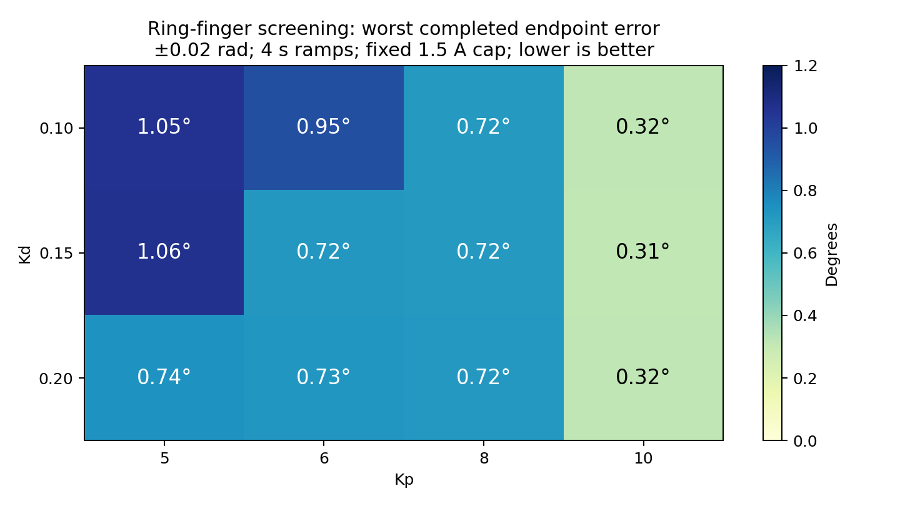

# Ring control stability and encoder association — 2026-10-27

**Kp 10/Kd 0.15 was selected as a provisional ring profile.** It was later
superseded by the [uniform whole-hand profile](wuji-uniform-profile-2026-10-27.md).
The following records the earlier ring-only selection. The operator requested
using it after the sweep. It is saved in `examples/xarm-wuji.json` and was applied
and read back on the disabled hand for **ring S1/S3/S4**, with the tested 1.5 A
current cap. The other seventeen joints retain Kp 1.5/Kd 0.1/0.5 A. The revision
is `right-hand2-ring-kp10-kd015-20261027-v3`; the saved home posture is unchanged.

The subsequent [whole-hand home retest](wuji-home-retest-2026-10-27.md) stopped
before home on thumb/pinky settling errors at an intermediate waypoint, with no
encoder event or oscillation guard trigger. The selected ring joints tracked
within 0.003807 rad at that waypoint; the other joints retained their original
gains. Full-hand home remains unqualified.

The sweep completed **15 trials, 76 endpoint waypoints and 38 returns**, with
**683,828 native diagnostic frames and no diagnostic code or guard stop**.
Two candidates also completed the larger, faster motion used in the earlier
warning runs. These results support a useful reduction in the observed ring
instability; they do not establish a unique optimum or qualify full-hand tasks.

## Screening results

Twelve combinations covered Kp 5/6/8/10 and Kd 0.10/0.15/0.20. Ring S1/S3/S4
moved together through ±0.02 rad with four-second quintic ramps, three-second
holds, and 120 Hz commands. Every combination completed both directional returns
without detected repeated oscillation or an encoder warning.

The table gives the worst absolute encoder-reported tracking error over all
three active joints and the four endpoint holds, in radians:

| Kp | Kd 0.10 | Kd 0.15 | Kd 0.20 |
| ---: | ---: | ---: | ---: |
| 5 | 0.018408 | 0.018551 | 0.012938 |
| 6 | 0.016567 | 0.012607 | 0.012703 |
| 8 | 0.012507 | 0.012511 | 0.012553 |
| 10 | 0.005529 | 0.005434 | 0.005534 |

Kp 10 gave approximately 0.31–0.32° worst error in this screen. Differences
between its damping values are too small to establish a meaningful accuracy
winner from one cycle each. The Kp 5/Kd 0.15 reference was repeated after the
grid: its worst error changed from 0.018551 to 0.012654 rad, demonstrating that
movement history affects this comparison. The commanded ring center was fixed
throughout, while actual starting positions were measured and recorded on every
trial; they were admitted only within 0.025 rad of that center. This is not an
exactly identical physical-starting-pose experiment or a randomized study.

The existing 0.02 rad active endpoint tolerance is broad relative to the small
excursion. A passed trial therefore means the guarded sequence completed, not
that its tracking was accurate. Some low-gain holds contained one-way settling
steps: the largest was 0.01229 rad on ring S3 at Kp 6/Kd 0.10, without qualifying
direction reversals. These were not the repeated oscillation observed at Kp 15.
They are additional reasons not to describe every passing setting as equivalent.

## Repeated validation at the earlier warning motion

Kp 10 at Kd 0.15 and 0.20 each ran three positive/return cycles and three
negative/return cycles: six returns and twelve endpoint waypoints per profile.
Excursions increased to **±0.04 rad** and ramps shortened to **two seconds**,
matching the earlier warning trials' amplitude and ramp duration. The current
posture differed from those older trials. Three-second endpoint holds and the
new early oscillation stop remained active.

| Profile | Return error range | Worst error over all endpoints | Largest three-second hold range |
| --- | --- | --- | --- |
| Kp 10 / Kd 0.15 | 0.000816–0.008705 rad (0.047–0.499°) | 0.010812 rad (0.619°) | 0.000479 rad |
| Kp 10 / Kd 0.20 | 0.002354–0.009895 rad (0.135–0.567°) | 0.010826 rad (0.620°) | 0.000814 rad |

Both profiles completed without detected repeated oscillation, encoder warnings,
or other guard stops. Return error remained direction-dependent. The largest
validation errors came from ring S1; S3/S4 worst endpoint errors were about
0.0043/0.0053 rad. Kd 0.15 had slightly better observed return errors and hold
stability, so it was selected provisionally. These limited repetitions do not
prove it is intrinsically superior to Kd 0.20 in other postures or tasks.

Across all fifteen trials, the largest reported ring current was 0.254 A and
maximum reported MCU temperature over the hand was 59.70 °C. No current-limit
flag was observed. Recorded host loss/reordering/duplicate/drop and RPC
retry/timeout counters remained zero. Current limits were held fixed; the study
does not attribute the improvement to changing the current cap.

## Is the twitch linked to the encoder warnings?

**The recorded events support an association, but do not establish causality.**

| Evidence | What it establishes |
| --- | --- |
| Both earlier `Enc1BitRate` events occurred during Kp 15/Kd 0.15 ring trials, after angle/current oscillation developed | The symptoms co-occurred. Offline application of the early detector crosses its threshold about 0.406/0.360 seconds before the respective warnings. |
| Two later Kp 15 replays stopped on oscillation, with no encoder warning; the operator confirmed a visible twitch in the second | Physical twitching can occur without an asserted encoder warning. Early stopping changes the opportunity for an accumulated warning to appear. |
| All fifteen new Kp 5–10 trials had no detected repeated oscillation or encoder warning, including twelve returns at the older motion size/speed | The lower-gain candidates avoided both observed symptoms in these tested conditions. |
| Five seconds of disabled diagnostic monitoring followed every new trial | No delayed code appeared during those observation windows. |

`Enc1BitRate` concerns the fraction of motor-side encoder frames carrying a
chip data-quality flag. Its threshold/window and the raw per-frame flags are
not exposed by the public device resources reviewed. A warning can therefore
lag the first degraded samples: oscillation preceding warning assertion does
not prove that mechanical movement preceded encoder degradation. Conversely,
no warning does not prove every encoder sample was good.

The possible mechanisms still include controller-driven motion degrading the
encoder signal, encoder noise causing the controller to move, and a shared
drive/firmware issue. Earlier warning runs had different starting postures and
different stop rules. These selected historical cases are not a controlled
warning-incidence experiment. The earlier reports retain the exact event and
source evidence: [encoder investigation](wuji-encoder-isolation-2026-10-27.md),
[watched replays](wuji-visual-replay-2026-10-27.md).

The useful operational result is that the moderate profile avoided the repeated
twitch in the tested motion without reproducing an encoder warning. Establishing
the direction of causality would require synchronized raw encoder-quality flags,
independent motor/output encoder angles, or vendor diagnostics; no public getter
for those measurements was found. No protection was relaxed to provoke another
encoder warning, and no hardware fault was declared resolved.

## Method, guards and selected configuration

All motion used the native SDK 2026.10.12 on the same right Hand 2, firmware
2.13.1. The xArm remained stationary in state 5. The ring current cap was always
1.5 A, host velocity/effort feed-forward was zero, and the previously used
firmware compensation mode 3 and position table were requested. Those firmware
terms are write-only; their effective calibration/state is not independently
read back. Inactive joints held fresh measured angles at 1.5/0.1/0.5 A.

The early oscillation detector was byte-identical to the regression-checked
watched-replay detector. Native diagnostic events were latched at subscription
rate, communication counters recorded, and existing motion/feedback/speed/current/
temperature guards retained. Every trial confirmed all twenty joints disabled,
observed diagnostics for five seconds, then restored and read back the original
profile. No candidate needed a guard-triggered interruption. Old STOP records
were preserved.

After the completed tests, the operator explicitly selected the best setting.
The saved twenty-element parameter arrays reproduce the tested active/held
joint split: flat indices 12/14/15 (ring S1/S3/S4) use 10/0.15/1.5 A; all others
use 1.5/0.1/0.5 A. Applying the selection issued only two parameter writes, with
no enable, motion command, fault clear or safety-disable call. All twenty
parameters were read back, another 7,025 diagnostic frames were clear, and the
hand remained disabled with the xArm unchanged. The settings are persisted in
the host configuration and reapplied by RAX's explicit preparation; no device
flash-save operation was requested. Existing session snapshots need regeneration
from the updated configuration to use the revision.

The configuration passed normal validation and **58 existing SDK/controller/
session-configuration tests**. No production controller implementation was
changed. In particular, the experiment's additional early oscillation detector
has not been added to the production controller. The selected gains are a
provisional ring setting, not a full-hand home or manipulation qualification.

## Evidence

The [trial CSV](wuji-ring-stability-sweep-2026-10-27.csv) includes screening,
reference repeat and repeated validation results. Exact scripts, per-case
specifications, shared commanded center, raw traces, post-disable observations,
selection readback and before/after configuration copies are retained under
`.local-runtime/wuji-ring-stability-sweep-20261027/`.

The local [evidence archive](../.local-runtime/wuji-ring-stability-sweep-20261027/wuji-ring-stability-evidence-2026-10-27.zip)
contains those records and a SHA-256 manifest. It has not been sent externally.
