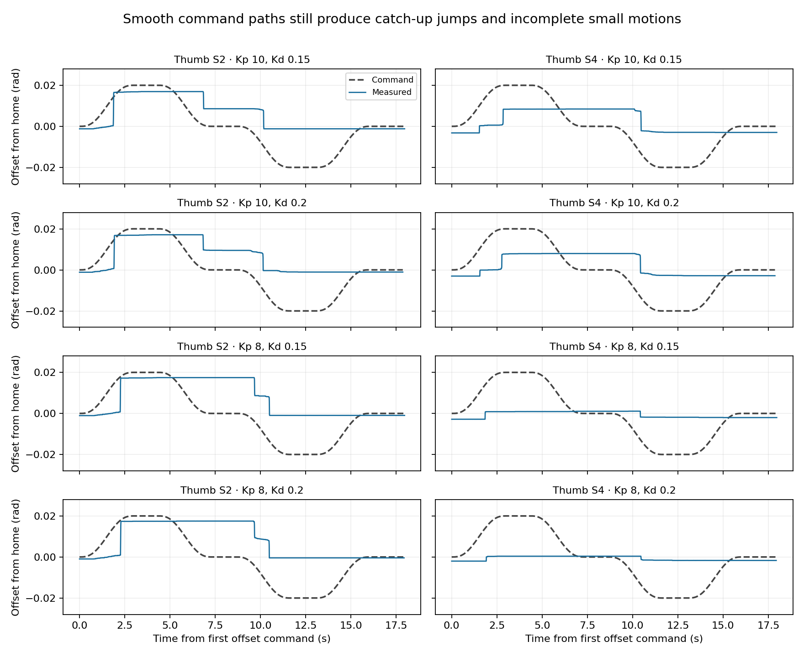

# Whole-hand smoothness comparison and parameter inventory — 2026-10-27

**Lower Kp did not provide a reliable smoothness improvement in this screen.**
Kp 8 reduced burst counts but worsened thumb home error and suppressed useful
thumb S4 motion. Kp 10/Kd 0.20 gave a modest, repeatable reduction in the number
of measured speed bursts, with similar endpoint tracking to 10/0.15. Peak-speed
ranges overlapped, so this is not evidence of a substantial smoothness fix.

After this comparison, Kp 10/Kd 0.20/1.5 A on every joint was provisionally saved
as `right-hand2-all-kp10-kd020-20261027-v5`. The hand was confirmed disabled and
hardware gains/caps read back. The operator's subsequent request to keep the
thumb stronger and use lower gains selectively on the other fingers starts a
separate experiment; this report records the uniform-gain comparison.

## All active control and motion parameters

These values describe the selected v5 profile and unchanged production defaults.

| Parameter | Value | Role |
| --- | --- | --- |
| Kp, each of 20 joints | 10 | Position-error feedback gain; v5 leaves it unchanged |
| Kd, each joint | 0.20, previously 0.15 | Velocity-error feedback gain; the selected change |
| Per-joint current cap | 1.5 A | Bounds current, not physical speed or fingertip force |
| Desired velocity sent to hardware | 0 rad/s | Production sends position-only references |
| Host feedforward current | 0 A | No host friction or constant-current bias |
| Command publishing | 120 Hz | Native position commands from RAX |
| Reference interpolation | Quintic | Smooth position, zero endpoint reference velocity/acceleration |
| Test ramp / endpoint hold | 3 s / 1 s | Experimental sequence timing |
| Maximum reference velocity | 0.5 rad/s | Trajectory admission; not a measured actuator-speed cap |
| Maximum reference acceleration | 1.0 rad/s² | Trajectory admission |
| Maximum command step | 0.35 rad | Distance between admitted targets |
| Maximum tracking discrepancy | 0.35 rad | Production tracking watchdog |
| Endpoint tolerance | 0.040 rad, all joints | Must persist for 0.2 s |
| Settling timeout | 3 s after ramp | Failure stops the assembly in the MCP path |
| Maximum trajectory duration | 60 s | Production admission bound |
| Feedback freshness / scheduler gap | 0.25 s / 0.10 s | Production state/diagnostic and scheduling watchdogs |
| Parent heartbeat timeout | 1 s | Stops on loss of supervision |
| Stop confirmation | 2 s timeout, ≤0.05 rad/s | Fresh feedback required |
| Joint position bounds and home | Unchanged, 20-element arrays in example config | Same physical reference and range admission |
| Firmware internal compensation | Not changed or reset in these trials | Earlier tests requested mode 3 and position table on; effective calibration/state has no verified readback |

Wuji documents the nominal PD-plus-feedforward law in its
[control guide](https://docs.wuji.tech/docs/en/wuji-hand/latest/control-guide).
Kp acts on position error; Kd acts on desired minus measured velocity. With zero
desired velocity, Kd contributes braking against measured movement. Its SDK
current units are amperes, not physical joint torque. Earlier telemetry indicated
an apparent gain/current scale near two; this comparison does not assume that
nominal gain values are independently calibrated physical gains.

The additional experimental guards were unchanged across all six trials:
startup temperature below 60 °C, stop at 65 °C; SDK-reported speed above 2 rad/s
or above 1 rad/s for more than 0.12 s; reported current above the configured cap
plus 0.15 A; any native diagnostic code, stale feedback or operator STOP marker.
The early repeated-oscillation detector uses a 0.15 s window (at least 0.12 s),
position span above 0.006 rad, reference span below 0.001 rad, and at least three
direction reversals above a 0.0005 rad step deadband. It remains test-only.

## Why test these factors

The preceding uniform 10/0.15 run passed endpoint checks, but the operator
reported visible jerkiness. Its thumb S2 trace showed error building while
position barely changed, followed by about 0.01292 rad of motion in 8 ms.
SDK speed peaked at 1.466 rad/s; native-timestamp position differences also
showed a large burst. The reference was already slow and smooth.

This pattern is consistent with stick-slip or another breakaway/load effect.
It does not uniquely establish friction, exclude encoder/firmware effects, or
prove that reducing stiffness will help: a lower Kp can require more error to
build before the joint moves. Raising Kd may brake the resulting burst, but
velocity-feedback dynamics and friction make the outcome empirical.

The 2×2 comparison changed Kp between 10 and 8 and Kd between 0.15 and 0.20.
Caps, timing, rate, reference positions, feedforward, firmware state requests and
guards were held fixed. The initial 10/0.15 baseline was repeated after the grid,
then 10/0.20 was repeated because its advantage was small relative to baseline
variation. This is a focused screen, not a statistical optimum search.

## Sequence and results

Every session seeded measured angles before enable, aligned to the same saved
home, and ran +0.02 rad → home → −0.02 rad → home on all twenty joints. Each
ramp took three seconds and had a one-second endpoint hold. Every session ended
with confirmed disable. Motion used the real MCP tools and production hand
controller, with bounded waits for fresh holding status between commands.

The command path was identical across cases; measured starting poses were
recorded and differed. Re-alignment reduces but does not eliminate effects of
motion history. Maximum ideal reference speed on a 0.02 rad ramp is 0.0125 rad/s.

Metrics below exclude the alignment move. Position-derived speed uses centered
finite differences across roughly 16–18 ms, using unique native state timestamps.
A burst is a contiguous interval where one joint exceeds 0.25 rad/s by this
measure. This is a comparative analysis threshold, not a vendor safety limit or
an independently validated perceptual jerk metric. SDK-estimated speeds and all
per-joint measurements are retained separately.

| Run | Kp / Kd | Peak position-derived speed (rad/s) | Burst count | Worst home-hold error (rad) | Thumb S2 home-hold error (rad) |
| --- | --- | ---: | ---: | ---: | ---: |
| a1-kd015 | 10 / 0.15 | 0.993 | 29 | 0.01147 | 0.00858 |
| b1-kd020 | 10 / 0.2 | 0.933 | 24 | 0.01037 | 0.00954 |
| c1-kp8-kd015 | 8 / 0.15 | 1.294 | 22 | 0.01746 | 0.01746 |
| d1-kp8-kd020 | 8 / 0.2 | 1.056 | 20 | 0.01750 | 0.01750 |
| a2-kd015 | 10 / 0.15 | 1.101 | 28 | 0.01133 | 0.00902 |
| b2-kd020 | 10 / 0.2 | 1.044 | 24 | 0.01027 | 0.00955 |

The two 10/0.20 runs had 24 bursts each, versus 28–29 for 10/0.15. Tracking RMS
was similar (~0.0058 rad). Position-derived peak speeds overlapped:
0.933–1.044 rad/s versus 0.993–1.101 rad/s. Thus the evidence supports only a
modest provisional damping change, with continued jerkiness unresolved.

At Kp 8, thumb S2 home error rose to about 0.0175 rad. Thumb S4 traversed only
0.0024–0.0040 rad against a total commanded span of 0.040 rad. Reduced movement
can reduce burst counts without improving useful motion. Even at Kp 10, thumb
S2/S4 each traversed less than half that commanded span in this small-motion
screen. The 0.040 rad endpoint tolerance is larger than each 0.020 rad excursion,
so a protocol pass here does not establish small-motion fidelity. This is a
material limitation, not a reason to label every passing candidate accurate.

## Final state and evidence

All 30 commands completed under the existing endpoint gate; there were no native
diagnostic events or additional guard triggers across 137,637
diagnostic frames. The separate disabled postflight observed
7,021 clear diagnostic frames and verified
10/0.20/1.5 A on every joint. Maximum recorded MCU temperature in the scored
comparison was 59.00 °C. The arm's
full pose remained unchanged and error-free in state 4. No production controller
code, home angles, trajectory limits or calibration was changed.

The [trial CSV](wuji-smoothness-2026-10-27.csv),
[per-joint CSV](wuji-smoothness-joints-2026-10-27.csv), and
[raw experiment directory](../.local-runtime/wuji-smoothness-20261027/) retain
commands, native/service traces, diagnostic records, configuration snapshots,
analysis code and readback. Visual feedback on the final damping comparison was
requested but not received before the operator proposed the per-joint experiment.
No no-twitch or visibly-smoother claim is inferred from silence.
