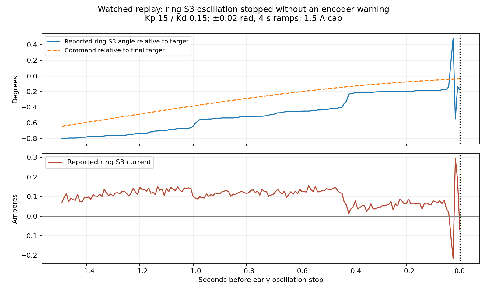

# Watched ring-finger replay — 2026-10-27

**The lower-stiffness replay completed steadily; two higher-stiffness replays
reproduced oscillating ring S3 feedback and stopped on the new early guard.
The operator confirmed a visible twitch during the second higher-stiffness
replay. No encoder warning was recorded in these three trials.** Physical
movement is now independently corroborated, although the encoder warning's
underlying cause remains unresolved.

The operator explicitly requested another test to observe trembling after
clarifying that the earlier warning trials had not been watched closely. Each
replay was announced with a ten-second lead time. The xArm remained stationary
in state 5 and fault-free throughout.

## What ran

Three separate native-SDK trials moved ring S1/S3/S4 together: positive excursion,
return, negative excursion, return. Excursions were ±0.02 rad (±1.15°), with
4-second quintic ramps at 120 Hz and 3-second endpoint holds. Both trials used
Kd 0.15, 1.5 A active-joint caps and zero host effort/velocity feed-forward;
firmware compensation mode 3 and the position table were requested as before.
Other joints held freshly measured angles at Kp 1.5/Kd 0.1/0.5 A.

| Trial | Active Kp | Outcome |
| --- | ---: | --- |
| Gentle replay | 5 | All four excursions/returns completed; no diagnostic or guard stop. Operator reported smooth motion without trembling or contact. |
| Higher-stiffness replay | 15 | First three moves completed; final return stopped on ring S3 oscillation. No native diagnostic code appeared. The operator later clarified they were not paying close attention; visible trembling is unknown. |
| Higher-stiffness repeat, explicitly requested | 15 | First three moves completed; final return stopped on ring S3 oscillation. Operator confirmed a visible twitch/tremble. No native diagnostic code appeared. |

These movements were smaller and slower than the earlier ±0.04 rad, 2-second
warning trials. A fresh measured center was taken before each replay, to avoid
forcing the disabled hand back to an old posture. Ring S3's centers differed by
0.01213 rad between these two trials, so this is not an exactly matched
starting-pose gain comparison.

The lower-stiffness trial's largest ring-joint range during any three-second
hold was 0.000307 rad (0.0176°). Its largest active endpoint error was
0.01582 rad (0.91°), substantial relative to the small commanded excursion.
Steady holding does not by itself establish accurate tracking.

## Higher-stiffness stop

During the last 0.150 seconds before detection on the final return:

- Ring S3 reported a 0.01798 rad / **1.03°** peak-to-peak angle change.
- Its command changed only 0.000487 rad / **0.028°**. It was nearly stationary,
  still approaching its endpoint; this was not an exactly constant-target hold.
- Three qualifying direction reversals triggered the early guard. Reported
  current ranged from −0.217 to +0.294 A, without a current-limit flag.
- Reported voltage was 12.371–12.405 V; MCU temperature was 54.97–55.00 °C.
- All twenty joints were confirmed disabled in feedback **23.9 ms after
  detection**. This is observed feedback timing, not a physical-stop guarantee.

The guard monitors all twenty reported joint angles at the command-loop rate.
It stops for a range above 0.006 rad with at least three direction reversals
larger than a 0.0005 rad step deadband, when the command range is below 0.001 rad,
over a rolling 0.15-second window spanning at least 0.12 seconds. These are
experimental thresholds, not vendor-certified safety limits.

Offline replay caught both historical warning traces about 0.406/0.360 seconds
before their diagnostic assertion. It also flagged a smaller held-ring-S3
oscillation in an earlier accepted isolated S1 test; that conservative threshold
was retained. Two other prior control traces passed. The original native
diagnostic latch, feedback, speed, temperature, lateral-drift and command-gap
stops remained in place. Additional current/departure bounds and an operator
STOP marker were checked. The new guard does not establish that an encoder
warning would necessarily have occurred if this motion had continued.

## State and interpretation

All three trials confirmed all twenty joints disabled afterward and read back the
restored Kp 1.5/Kd 0.1/0.5 A profile. All disabled preflights were clean. The
first higher-stiffness run's STOP marker was preserved; the operator explicitly
requested one further bounded repeat, documented below. That repeat created its
own STOP marker and no further motion followed. No production
controller/configuration, saved home, camera calibration or firmware was changed.

The higher stiffness again improved the completed endpoint errors, to
0.00129–0.00360 rad, but the final return oscillated. The interrupted endpoint is
not a pass. This strengthens the case for a control/feedback interaction. The
watched repeat now confirms some real physical twitching accompanies the
telemetry. It does not independently measure its exact angle, or distinguish
controller-driven vibration from encoder noise causing the controller to move.
No new native encoder warning was reproduced in these bounded trials.

## Explicitly requested repeat and visual confirmation

After missing the first higher-stiffness event, the operator requested another
replay and confirmed afterward: **“Yes—visible twitch or trembling.”** The same
unchanged harness, guard thresholds, gains, caps and trajectory specification
were used, with a fresh disabled baseline and a ten-second countdown. This was
one authorized replay, not an automatic restart after a guard stop. The new
preflight received 7,010 diagnostic frames with no code; all joints were disabled
and the original profile was confirmed before enabling.

On the final return, ring S3 reported **0.01356 rad / 0.777° peak-to-peak** while
its command changed **0.0531°** over the detector window. Reported current ranged
from −0.193 to +0.304 A. All twenty joints were confirmed disabled **22.9 ms**
after detection. No native diagnostic code appeared. Original settings were
restored and read back; the xArm's state, faults and pose were unchanged.

The new center again came from the current measured posture, so this is not an
exact starting-pose reproduction. Nevertheless, the same joint, final-return
phase and qualitative angle/current behaviour recurred, now with an independent
visual report of physical movement. It is not appropriate to dismiss these
events as purely a plotted telemetry artifact. It remains possible that encoder
noise initiates the physical response, and the relationship to `Enc1BitRate`
requires further isolation.

Repeat evidence is retained in `.local-runtime/wuji-visual-repeat-20261027/`,
including the authorization record, unchanged harness, fresh baseline and
preflight, raw trace, stop/restoration readbacks and operator observation.

Exact harnesses, specifications, fresh baselines, readbacks, both raw traces,
guard regression results and summaries are retained in
`.local-runtime/wuji-visual-replay-20261027/`. See the
[preceding encoder investigation](wuji-encoder-isolation-2026-10-27.md) for the
two earlier diagnostic events and public-source research.
