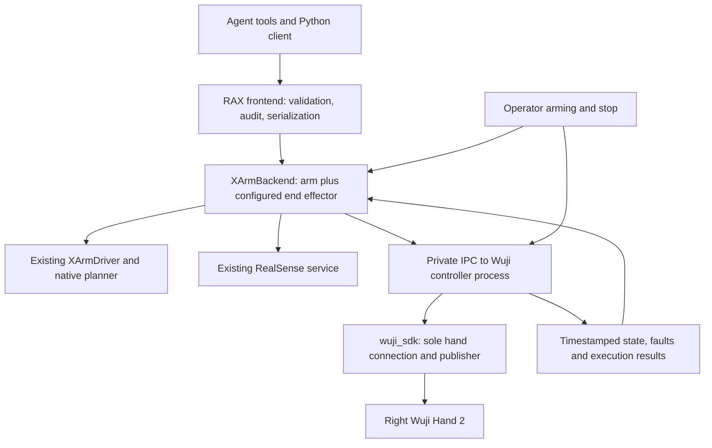

# xArm + right Wuji Hand 2 backend plan

Research date: 2026-10-25. Branch: `real/xarmwuji`, based on `b799778`.
Status: design baseline followed by the implementation in this branch. See
[the setup and testing guide](xarm-wuji.md) for the implemented interface and limits.
Hardware commissioning remains pending; no device settings were changed during implementation.

**Recommendation:** retain RAX's xArm backend and native arm motion planner, and
compose it with an independently supervised Wuji Hand 2 controller. Select the
end effector through configuration. Give the hand explicit joint-space tools,
state, and skills instead of translating twenty joints into gripper width.

## 1. The actual starting point

The user confirmed the installed device is a **right Wuji Hand 2**, attached to the
same xArm that previously worked with a G2 gripper. Local deployment evidence is in
`/home/jerry/xe-eval-deploy/bimanual/eval_robotics_xarm_bimanual/`.

| Item | Evidence and implication |
| --- | --- |
| Working SDK | `wuji-teleop/requirements.txt` and installed package metadata pin `wuji-sdk==2026.10.12`; Python 3.12. Start with that version. |
| Recorded working hand | `WH2KA01260823017`, right, firmware `2.6.0`, endpoint `192.168.1.111:7447`. Require an exact serial match at connection. |
| Recorded physical success | `wuji-teleop/self-check-20261022-1319/README.md`, `thumb-opposition.json`, and `run-info.json` record an official thumb-opposition PASS on October 22. The subsequent snapshot had all twenty joints Ready/disabled and no active errors. This is historical evidence, not today's health reading. |
| Hardware revision | The serial contains `A01`, identifying Hand 2.2 under Wuji's [revision rules](https://docs.wuji.tech/docs/en/wuji-hand/latest/version-compatibility). Use the right 2.2 model. |
| Existing control patterns | `wuji-teleop/control.py` has a ramped, speed-limited 120 Hz teleoperation loop. `pen_flip/native_control.py` contains stricter full-state decoding, bounded trajectories, parameter readback, and confirmed-disable cleanup. The existence of this latter script alone does not establish a successful physical trial. |
| Existing integration prototype | `arm-hand-adapter/arm_hand/drivers.py` separates the two devices and checks complete feedback. Its README explicitly describes hardware motion as unverified. Borrow focused components and tests; preserve RAX's working arm control path. |
| Optional sensors | The adapter's October 22 record reports all fingertip sensor online flags false. Detect availability; don't assume tactile sensing. |

Do not silently select the other recorded right hand, `WH2KA01260723002`: its
separate historical fault report documents a ring-joint fault. It is a different
device, despite sharing the recorded IP. Recheck identity when bringing up RAX.

The deployment also uses arm `XI130510J56A20` at `192.168.100.16`, whereas RAX's
checked-in example uses `192.168.2.205`. Preserve the intended arm's actual runtime
configuration and verify its identity; neither example address proves the current
connection. Recorded host interface names and routes have changed between trials.

## 2. What the official documentation establishes

The maintained package is `wuji-sdk`, imported as `wuji_sdk`. It supports Hand 2
directly through Python. The older `wujihandpy` repository is archived and is not
the starting point for this device. No ROS dependency is needed for this backend.
Sources: [current SDK](https://github.com/wuji-technology/wuji-sdk),
[release history](https://github.com/wuji-technology/wuji-sdk/blob/main/CHANGELOG.md),
[archived SDK](https://github.com/wuji-technology/wujihandpy).

Hand 2 runs MIT impedance control. Commands contain twenty positions, velocities,
and feedforward efforts. Positions are radians, velocities rad/s, and effort is
**amperes**, not joint torque or fingertip force. The SDK order is thumb, index,
middle, ring, pinky, four joints per finger, labelled `S1` through `S4`. The guide
does not yet establish the complete SDK-to-model axis mapping; validate it before
trusting model-based limits or fingertip FK. Source:
[control guide](https://docs.wuji.tech/docs/en/wuji-hand/latest/control-guide).

Subscribe to both `joint_states()` and `joint_diagnostics()`. Frames contain only
online joints and identify entries by `nid`; arrival order is not joint order.
Use `WujiHand2.nid_to_joint_index`, reject duplicates and missing joints, and never
fill missing positions with zero. Subscription `recv()` returns queued frames;
consume promptly and retain the newest valid state. Sources:
[joint API](https://docs.wuji.tech/docs/en/wuji-hand/latest/sdk-reference/joint-control),
[diagnostics API](https://docs.wuji.tech/docs/en/wuji-hand/latest/sdk-reference/diagnostics).

Connect by configured serial and verify type and handedness. Explicitly set
`ConnectOptions(enable_bridge=False)`: sharing is enabled by default. For address
connections, use the verified endpoint including port and then verify serial.
Today's default port is 50001, but the working local firmware used 7447. Do not
change firmware, addressing, or ports just to match current examples. Sources:
[connection API](https://docs.wuji.tech/docs/en/wuji-sdk/latest/device-connection),
[device operations](https://docs.wuji.tech/docs/en/wuji-hand/latest/sdk-reference/device-operations).

Gains and current limits need explicit readback. Reads can contain unavailable
entries; connection success alone does not verify control parameters. The official
self-check changed the local hand's gains from `(1.5, 0.1)` to `(3.0, 0.05)`.
Do not assume settings left by another program match a RAX profile. Parameter
writes need failure handling and complete readback before enabling. Source:
[effort and MIT parameters](https://docs.wuji.tech/docs/en/wuji-hand/latest/sdk-reference/effort-and-mit).

Wuji documents a motor stop on communication loss for Hand 2 firmware 2.1.0 and
later, followed by explicit re-enable. Its exact stopping latency and response to
a stalled application that leaves SDK traffic alive still need verification.
The hand has independent power and Ethernet; the arm's stop cannot be assumed to
stop it. Source:
[hardware integration](https://docs.wuji.tech/docs/en/wuji-hand/latest/hardware-integration).

## 3. Preserve the arm; compose the hand

Keep `robot: "xarm"` and existing arm tool names, SI units, base-frame poses,
quaternion convention, RealSense service, depth projection, recording, and
session protocol. Add `backend_options.end_effector.type`, with `wuji_hand2` for
this setup and a compatibility path for existing G2 configurations.

Use a small end-effector factory with shared lifecycle, status, tool-registration,
and stop hooks. Keep G2 width commands and Wuji joint commands as separate
capabilities. Initially a G2 adapter can delegate to the existing methods on
`XArmDriver`; relocating that working SDK code is optional.

For Wuji, use a dedicated trusted controller process, following the repo's existing
camera-process pattern. This adds a narrow IPC boundary but separates continuous
hand control from image processing, MCP waits, and native SDK delays. Keep it
private to the backend and operator controls. A standalone ROS stack or the entire
external arm-hand RPC service would add unnecessary coupling to this first port.

The process owns the SDK handle, subscriptions, command publisher, trajectory,
and immutable state snapshots. The parent owns policy and the existing arm.
Use a device-level lease, not just the frontend's per-session lock. Coordinate
with the existing teleop/native-control locks during migration; differently named
lock files do not exclude each other. Bridge disabling and advisory locks do not
stop arbitrary vendor programs from sending commands.

## 4. Hand execution and lifecycle

Connection should discover/identify the device and collect state without enabling,
homing, clearing faults, or moving fingers. Represent disconnected, connected but
disabled, enabled and holding, executing, faulted, and uncertain states separately.
SDK "Ready" means disabled; all twenty joints must report Enabled for execution.

An explicit operator preparation action through the owning process should:

1. Require fresh, complete, fault-free state and diagnostics from the expected hand.
2. Read the current gains and current limits, apply the chosen operator profile
   while disabled if requested, and verify all twenty readbacks.
3. Seed the publisher from measured positions before enabling, then confirm all
   twenty enabled states from new feedback. An enable RPC returning is insufficient.
4. Maintain the initial pose; do not assume zero radians means a safe open hand.

Start with a configurable **120 Hz host loop**, based on the successful local
teleoperation path. This is a scheduling target, not a real-time guarantee. The
existing native-control script's 250 Hz loop is another reference, not a reason
to require that rate. Measure scheduling and feedback latency with cameras active.

Each accepted motion supplies a complete twenty-joint goal. Interpolate from the
active target with bounded velocity and acceleration; reject an unresolved large
tracking discrepancy before a new trajectory. Bound elapsed-time advances and
stop on excessive scheduling gaps rather than catching up with a command burst.
Use zero feedforward current initially and operator-set gains/current caps.

The local teleop profile used 0.5 rad/s, a five-second startup ramp, 1 A, and
`kp=1.5, kd=0.1`. These are useful commissioning evidence, not universal safe
defaults. The newer native script has different settings. Record the selected
profile and verify it on the mounted hand before autonomous manipulation.

Monitor state and diagnostic freshness independently, online count, enabled
states, errors, tracking, scheduling, parent liveness, and arming expiry. Existing
local implementations use 0.25–0.5 s feedback thresholds; measure and select the
RAX threshold explicitly. Retain source sequence/timestamps plus host monotonic
receipt times. Detect stalled sequences and backlog; dequeuing old data must not
renew the freshness deadline indefinitely.

Keep holding the accepted final target between agent calls and during arm moves.
Agent deliberation is not a communication failure. Parent/controller failure or
operator disarm is. A completed hand tool must not close its publisher or disable
the hand, which could release an object.

Use a command ID and cancellation generation so delayed replies or late SDK
returns cannot resume an aborted trajectory. All normal SDK writes use one owner.
Stop requests preempt queued goals; after an in-flight native call returns, apply
the pending stop again before accepting anything else.

## 5. Tools and observations

| Proposed tool | Contract |
| --- | --- |
| `wuji_status` | Identity, capability/profile versions, twenty measured/target positions, velocity, effort in A, diagnostics, freshness, enabled state and current action. |
| `wuji_move_joints` | Exactly twenty finite positions in the published order, optional bounded duration. Host enforces joint/rate/step limits and arming. Returns completion and measured errors. |
| `wuji_pose` | Execute an operator-commissioned named posture through the same validator and controller; include its profile revision in results. |
| `wuji_hold` | Cancel hand trajectory and enter a bounded stationary target hold when feedback is healthy; report fallback stop and uncertainty otherwise. |
| `xarm_hold` | In a Wuji session, stop the assembly: dispatch independent arm and hand stop requests and report each outcome. |

Wuji sessions omit `xarm_gripper`. G2 sessions retain it. `xarm_status` includes
the hand snapshot and capabilities; it must not invent width or `is_grasped`.
Status should remain readable when a hand is faulted or missing, with stale fields
identified and unavailable measurements represented as null.

Validate shapes, numeric types, finite values, unknown fields, and configured
bounds in backend code before mutation. Published JSON Schema alone is not enough:
the current frontend does not generically enforce every schema constraint.
Recheck live admission immediately before dispatch. Register hand motion tools
with the frontend's mutation/error handling and preserve `control_uncertain` when
state or stopping outcomes cannot be verified.
Stop tools remain available when disarmed or uncertain and must not require the
normal motion-admission checks to pass.

Return distinct outcomes such as reached, stopped, target-not-reached, fault, and
uncertain. A blocked finger is neither proof of a grasp nor a reason to increase
current automatically. Start with posture control and visual verification; a
contact-aware grasp controller needs its own termination and retention criteria.

Preserve the accepted grasp target during carrying. Replacing it with measured
contact angles can remove holding effort. An ordinary hold can freeze the current
commanded trajectory sample, with zero target velocity and bounded tracking error;
it must not silently become an "open" command. Qualify this behavior on hardware.

Add hand snapshots to observations, stream records and motion clips. Record state
age at camera capture rather than claiming exact synchronization. Keep detailed
hand telemetry separate from compact agent summaries, with bounded storage and
both commanded and measured joints. Tactile data is optional: detect online
sensors, validate their declared data format and units, and report unavailable
sensing honestly. See the official
[fingertip example](https://github.com/wuji-technology/wuji-sdk/blob/main/examples/python/wuji_hand_2/3.fingertip_typed.py).

## 6. Stopping, frames, and ownership details

The hand worker checks arming even when the frontend is idle or waiting for an
operator. Parent monitoring notices hand faults and requests arm stop. Arm
execution failure requests hand stop. Dispatch both stops independently so one
exception cannot suppress the other. Correct the existing joint-motion path's
guard-exception handling while adding this coordination.

Separate normal holding from operator disarm/emergency. For the latter, cancel
all goals and request the hand's native emergency stop as well as arm hold; no
automatic re-enable or fault clear. Explicit disable and process teardown need a
documented object-support procedure because grip retention is not guaranteed.
Track requested, SDK-returned, and feedback-confirmed outcomes independently.
Never report both devices stopped solely because two SDK calls returned. Process
isolation also cannot guarantee stop delivery after cable or power loss.

Keep the agent away from direct hand Ethernet access and private controller IPC,
including SDK-sharing paths. Review the existing launcher socket exclusions and
network mediation. Dashboard and logging read the owner snapshot; they must not
create additional Wuji clients. Operator lifecycle actions use that same owner,
with a device lease when operating outside an active RAX session.

Use explicit transforms: xArm flange to `r_mount`, mount to palm reference, and
camera mounting transforms. A fixed palm/TCP frame is suitable for arm commands;
each fingertip moves with finger joints. State must identify the configured TCP.
Do not silently replace the old G2 TCP with a guessed palm offset.

Recommission payload mass/centre of mass, mounting orientation, hand clearance,
and the configured TCP. Existing workspace/FK checks constrain the TCP, not the
whole hand. Start with a verified conservative hand envelope; full per-link checks
need validated model mapping and mounting geometry. Vendor model assets are
available in [wuji-description](https://github.com/wuji-technology/wuji-description).
The local deployment pins model commit `829c9aa27cb12c3a49d5b8d63c9869dd8f656702`.

The deployment's `docs/wuji_hand2_review/applied.json` records a controller collision
box, but on arm `.16`; don't apply it blindly here. Its adapter configuration also
marks mounting and joint mapping unverified. Model loading is not calibration.

Fixed-camera calibration remains usable if the base and cameras did not move.
The current wrist-camera transform is expressed relative to the configured TCP:
changing that TCP requires transforming the calibration using known rigid
transforms or recalibrating, even when the camera itself did not move.

## 7. Skills found on the other RAX branches

GitHub branch heads were checked against local refs on October 25. The most relevant
skills are identical between `dexjoco/native` (`bcd748c`) and
`dexjoco/container` (`e600e99`). They describe **simulated Panda + Allegro**, not Wuji.

| Existing source | Reuse | Rewrite or defer |
| --- | --- | --- |
| [DexJoCo hand-control](https://github.com/RoboticsCenter/rax/blob/bcd748cfcff5e2fe53d5025afc239c89285e9e1e/agent_skills/control/dexjoco/hand-control/SKILL.md) | Preshape, gradual closure, retaining commanded targets during carrying, visually checking grasp/release, supported release. | All sixteen-joint layouts/ranges, thumb posture numbers, weak-servo assumptions, and the suggestion to squeeze 0.2–0.4 rad past contact. |
| [DexJoCo robot-interface](https://github.com/RoboticsCenter/rax/blob/bcd748cfcff5e2fe53d5025afc239c89285e9e1e/agent_skills/control/dexjoco/robot-interface/SKILL.md) | Explain hand vs flange frames and measured vs commanded state; zero vectors are not holds. | Simulation action rows, rotation-vector API, mirrored Allegro order, timing and controller response. RAX retains its existing quaternion arm API. |
| [DexJoCo motion-preview](https://github.com/RoboticsCenter/rax/blob/bcd748cfcff5e2fe53d5025afc239c89285e9e1e/agent_skills/control/dexjoco/motion-preview/SKILL.md) | Preview unknown shapes/clearance before execution when a validated preview exists. | Do not install a skill that advertises simulator tools this branch does not have. |
| [DexJoCo learn-from-experts](https://github.com/RoboticsCenter/rax/blob/bcd748cfcff5e2fe53d5025afc239c89285e9e1e/agent_skills/control/dexjoco/learn-from-experts/SKILL.md) | Learn posture and task phases from recorded evidence, then reacquire current geometry. | Simulator trajectories, automatic replay assumptions and unavailable expert datasets. Later optional addition for local hand demonstrations. |
| [Rainbow grasping](https://github.com/RoboticsCenter/rax/blob/36c926ca3cf15921c6fc746a4bf309c26b0aa3c4/agent_skills/control/rby1/grasping/SKILL.md) | Verify physical fingertip geometry, small lift checks, release only when supported. | Two-finger width, wrist-force thresholds, homing sequence, and interpreting amperage as grip force. |

These files are research inputs, not instructions to operate this hardware now.

Add an `end_effector` axis to `Setup` and workspace recipes. Use configuration-derived
capabilities for both tool publication and rendered skill context, so those two
views cannot drift. Proposed layers:

- `control/xarm/robot-interface`: arm frames, motion, limits and assembly stop;
  link to the installed end-effector skill.
- `end_effectors/wuji_hand2/hand-control`: exact twenty-joint order, posture/profile
  discovery, gradual motion, holding targets, visual grasp checks, fault response,
  and the distinction between current, contact and grasp success.
- `end_effectors/wuji_hand2/hand-control/references/`: joint mapping, commissioned
  posture descriptions and observation examples, versioned with the hardware profile.
- `end_effectors/g2/gripper-control`: retain the existing G2 behavior and examples
  when building a G2 workspace.

Keep existing Franka and mock workspace generation valid through compatible
default selection; deriving skill context must not open a hardware connection.

Update `auto_research_agent/AGENTS.md`, task `autonomous-control` and
`manual-robot-control`, wrist-camera inspection, live-stream descriptions, and
`api/stream.py`. Replace unconditional gripper calls, "gripper open" resets, and
scalar-width assumptions with the selected end-effector capability. Keep neutral
postures explicit; an empty hand should not automatically be driven to all zeros.

Document hardware/profile provenance in experience memory: side, serial, SDK and
firmware, origin/mapping revision, gains/current profile, TCP/mount revision and
camera calibration. A successful pose from another setup is a candidate, not an
immediately executable target. Skills should describe implemented and verified
capabilities; add each skill change with its corresponding backend feature.

## 8. Implementation sequence and acceptance checks

| Stage | Concrete work | Acceptance |
| --- | --- | --- |
| 1. Configuration and adapter boundary | End-effector selection, exact identity, pinned SDK, injectable Wuji driver, complete state decoding; keep G2 delegation. | Hardware-free tests reject missing/reordered/duplicate/nonfinite state correctly; constructor sends no motor commands; legacy G2 sessions still build. |
| 2. Owned hand service | Private process/IPC, device lease, fresh snapshots, independent watchdog, explicit preparation/stop, bounded execution. | Fake-driver tests cover stale diagnostics despite fresh positions, process/parent loss, disarm during idle and execution, late native return, failed stop and no automatic resume. Then perform a fresh read-only device check. |
| 3. Commission mounted hand | Confirm serial/revision, joint directions and origin, selected parameter profile, network route, TCP/payload/mount and camera geometry. | Operator-supervised small empty-hand motions, enable/disable feedback, target continuity, and stop behavior are recorded. No grasp claim based on joint convergence. |
| 4. RAX tools and workspace | Register hand tools and mutation handling, composite stop, hand-aware status/observation/recordings, operator CLI/dashboard, hand skill and template changes. | Generated Wuji workspace exposes the actual hand tools and has no G2 action examples; G2 workspace retains its tools. Both task modes and observation profiles render without unresolved variables or broken skill links. |
| 5. Manipulation | Commission open/pregrasp/release and task-specific postures, verify target retention while the unchanged xArm planner moves. | Demonstrate a supervised pick, short carry, supported release and recovery with synchronized evidence and measured final state. |

Test the shared frontend path too: invalid goals do not mutate; rejected commands
remain distinguishable from uncertain execution; stopping one device still happens
when the other raises. Confirm the operator stop path bypasses the long-running
frontend call lock. Do not run vendor motion demos as automated tests.

Start with sequential arm/hand operations while the hand maintains its target.
Synchronized 26-joint trajectories, retargeting/glove input, tactile grasp control,
fingertip Cartesian control and a full assembly simulator are later capabilities.
They can use the same hand service without replacing the current arm planner.

## 9. Expected file changes

| Files | Responsibility |
| --- | --- |
| New `services/wuji/sdk.py`, `controller.py`, `client.py` | Vendor boundary, owned execution process, private IPC client. |
| New `services/xarm/end_effectors.py` | Factory and G2 compatibility wrapper; minimal shared capability contract. |
| `services/xarm/backend.py` | Compose hand, select tools, validate/dispatch, coordinate stop, include hand state and recordings. |
| `services/xarm/sdk.py` | Preserve arm control; optional later relocation of G2-only code. |
| New `examples/xarm-wuji.json` and versioned hand profile | Exact device selection and operator limits; actual arm/camera settings copied from the intended running setup. |
| `services/workspace/setup.py`, `recipes.py`, and `recipe.py` as needed | End-effector axis, capability-derived tools and context, skill layer selection. |
| Skill/template files listed above | Hand-specific instructions and executable examples matching the tools. |
| `scripts/xarm`, `services/dashboard/sessions.py`, dashboard UI | Owner-mediated hand readiness/stop/status; replace scalar gripper display for Wuji sessions. |
| `harness/claude_cli/launcher.py` | Protect hand-control IPC and review direct-network/SDK-sharing access. |
| `local_tests/` | Fake hand/process tests, frontend failure cases, workspace rendering and G2 regression. |

Before physical commissioning, the remaining facts to establish are the current
device identity/health, the current arm address/serial, mounting/TCP/payload,
camera mounting changes, SDK-to-model mapping, optional sensor availability, and
the measured stop/watchdog behavior. These do not block implementing the adapter
and its hardware-free tests.
